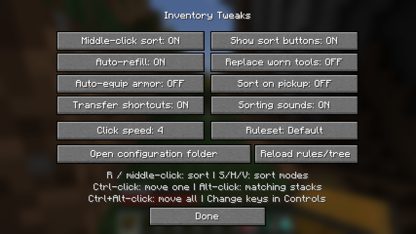

# Inventory Tweaks — NeoForge 1.21.1

An **unofficial** port of [Inventory Tweaks](https://github.com/Inventory-Tweaks/inventory-tweaks) for **Minecraft 1.21.1 / NeoForge / Java 21**, maintained in ReversTeams. Original authors and MIT license notices are retained.

The original repository targets 1.12.2. The 1.21.1 implementation replaces its Forge coremod/container transformation and networking layers with modern client events and ordinary vanilla inventory clicks. The historical implementation remains in `src/main/`; the active build uses `src/neoforge/`.

## Features

- Inventory and storage sorting with stack consolidation and compact, horizontal-row and vertical-column layouts.
- Default hotbar locks; configurable row, column, rectangle, locked/frozen-slot rules and named rulesets.
- Hierarchical XML item trees, registry-ID and `#item_tag` rules, and registry-ID sorting for unknown items.
- Stack/tool auto-refill, including offhand items and consumable remainders. Optional replacement before tool breakage.
- Optional better-armor equipping when sorting, and sorting after item pickup.
- One-item, matching-stack and bulk-transfer shortcuts.
- Crafting-grid stack balancing without touching the crafting output.
- Settings screen, Controls key bindings and storage sort buttons.

This is a client mod. No Inventory Tweaks server installation or custom network packets are required. Dedicated servers can also load the jar without initializing its client entry point. Server plugins or custom menus may impose additional restrictions.

## Install and controls

Use Minecraft **1.21.1**, NeoForge **21.1.x** (tested with **21.1.265**) and Java **21**. Put the release JAR in the client's `mods` folder. Do not install the source JAR or source ZIP as a mod.

| Action | Default control |
| --- | --- |
| Sort player inventory, or the hovered storage section | **R** |
| Sort hovered storage / balance hovered crafting inputs | **Middle-click** |
| Compact / horizontal / vertical storage sort | **S / H / V** buttons |
| Move one item to the other inventory | **Ctrl + left-click** |
| Transfer matching stacks | **Alt + left-click** |
| Transfer all stacks in that section | **Ctrl + Alt + left-click** |
| Settings | **...** beside the inventory, or Mods → Inventory Tweaks → Config |
| Cycle a named ruleset | Settings button, or assign a key in Controls |

The sort key is rebindable in Controls. Change it if another installed mod also uses R.



## Rules and configuration

Files are created in **`config/inventorytweaks-1.21/`**:

- `InvTweaks.cfg`: feature toggles and click speed (`clicksPerTick`, 1–16; default 4).
- `InvTweaksRules.txt`: placement/lock rules and named rulesets.
- `InvTweaksTree.xml`: original hierarchical item tree with common legacy IDs/classes adapted, plus modern registry-ID/tag support.

Rows **A–C** are the main inventory; row **D** is the hotbar. Columns are **1–9**. Examples:

```text
Default:
D LOCKED
A1 minecraft:diamond_pickaxe
B #minecraft:planks
C edibleFood

Mining:
D LOCKED
A1 minecraft:iron_pickaxe
A2 minecraft:torch
C FROZEN
```

Targets also support rectangles (`A1-C4`), reverse order (`A1-C4R`) and vertical traversal (`A1-C4V`). `LOCKED` excludes positions from ordinary sorting; a placement rule explicitly targeting a locked position can use it. `FROZEN` always excludes its positions. The default `D LOCKED` keeps the hotbar in place.

Tree entries can use `id="mod:item"` or `tag="namespace:tag"`; parent element names become category keywords. Rules also accept `namespace:*`. `autorefill nothing` disables auto-refill for that ruleset; `autorefill keyword` limits refill to matching items. Configuration reloads on sorting, or through the settings reload button. Invalid XML retains the previous valid tree/rules and reports the error in the log.

The before-break threshold uses the original property spelling `autoRefillDamageThreshhold`. `refillWithSimilarTools` allows a same-tool-class fallback if an exact replacement is unavailable.

## Menu support and behavior

Vanilla chests (including double/ender chests and barrels), shulker boxes, hoppers, and dispensers/droppers are supported. Generic mod storage is accepted when it exposes ordinary unrestricted slots. Machine outputs, armor/offhand slots, creative inventory and restricted custom slots are not treated as sortable storage. The crafting-grid operation only balances existing compatible input stacks.

The planner preserves item components and stack counts. Execution checks the expected contents before and after each click. If the menu changes unexpectedly it stops; it does not issue drop/outside-slot clicks or overwrite server inventory contents. A stack already picked up when an operation is interrupted remains a normal carried stack that can be placed manually.

## Build and validation

With a Java 21 JDK:

```powershell
.\gradlew.bat build
```

Release JAR: `build/libs/`. Read [PORT-STATUS.md](PORT-STATUS.md) for evidence and compatibility limits. The [validation project](validation/README.md) runs real Minecraft menu and client/network checks.

This branch's GitHub workflow builds the mod and runs the dedicated menu tests; it does not publish to CurseForge or Modrinth.

## Compatibility notes

This is a modern implementation of the original features, not binary compatibility with the 1.12 coremod/API. The source API uses modern `ItemStack` types; clients can access `ClientController.INSTANCE` through `InvTweaksAPI`. Old ASM container annotations, NEI/JEI integrations, arbitrary legacy NBT/metadata selectors and automatic merging of extra tree files are not carried over. Use modern item IDs or item tags for those rules. Old 1.12 shortcut-key property mappings are replaced by the controls above. The new settings labels are English; original localization resources are retained.

Historical configuration is not overwritten. Existing 1.12 configuration needs review before copying it into the new folder. Custom mod menus and a large combined modpack have not been exhaustively tested.

## License and attribution

MIT. Original Inventory Tweaks by Marwane Kalam-Alami, Andrew Crocker and contributors. See [LICENSE.md](LICENSE.md), preserved source notices, and [the historical README](README-1.12.md). This unofficial port is not endorsed by the original maintainers.
